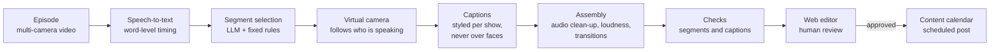

# Podcast shorts factory

Turns full video-podcast episodes into vertical shorts with one click from a web editor. A person still approves every short before it is published.

## The problem

Cutting shorts by hand from a long multi-camera episode is slow. You have to find the moments, frame the person who is talking, write and place the captions, export and schedule.

## How it works

- **Selection:** an LLM proposes candidate moments from the transcript, and fixed rules on top decide what is kept, so the result does not depend on the model alone.
- **Framing:** face detection drives a virtual camera that cuts to the person speaking.
- **Captions:** they are word-timed, styled for each show, and moved away from faces automatically.
- **Review:** the editor can trim, change the framing and restyle all captions at once. Approving sends the short to the content calendar as "in review".

## Results

- 122 shorts produced for one podcast, 48 published.
- About **US$0.04 of AI cost** and **70–90 seconds of processing** per short.
- On the same podcast, the long-episode workflow went from about **5 days to about 5 hours**: AI does the repetitive first pass, the editor does the creative part, and a final quality check closes it.

## Stack

Python · Whisper (faster-whisper / MLX) · LLM via OpenRouter (DeepSeek) · OpenCV face detection · ffmpeg and libass · audio denoising and loudness normalization · WebGL transitions rendered in headless Chromium · a web editor and content calendar

---

The source code is private because it runs in production. I'm happy to walk through it on a call.
